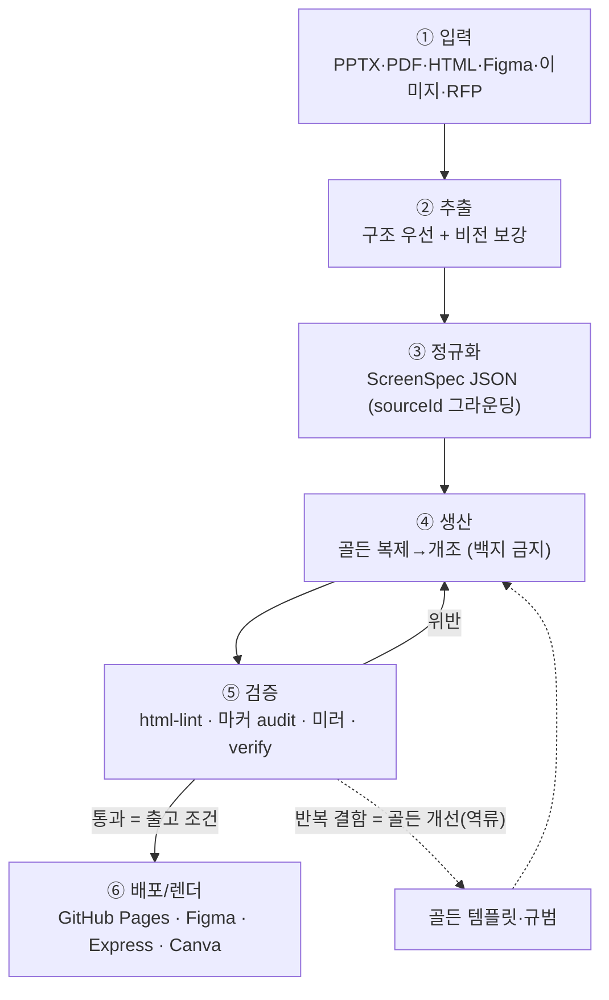
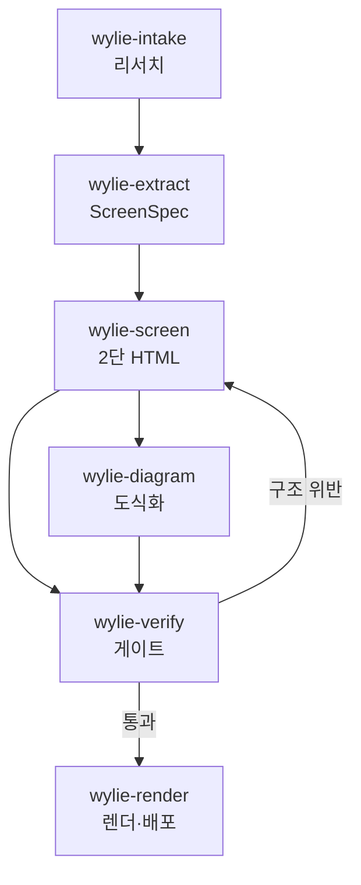

# 와일리(Wylie) OS 통합 핸드북 — 학습·이식·재개발용 단일 문서

> **이 문서 하나로** 다른 세션(또는 다른 저장소)이 와일리 OS를 이해하고, 스킬·훅·에이전트·기능으로 **다시 만들 수 있도록** 이 세션의 모든 대화·노하우·화면·검증·인사이트를 통합했다.
> 발주자: **박재하 본부장님** · 빌더 페르소나: **와일리(Wylie)** · 원천 저장소: `parkh37t/con-ai` (브랜치 `claude/adoring-clarke-5gizmq`)
> 작성일: 2026-11-14 · 근거: 커밋 23개, 파일 92개(HTML 17·MD 64·PY 5·CSS 2·JSON 2)

---

## 목차

0. [이 문서 사용법](#0-이-문서-사용법)
1. [한눈에 보기](#1-한눈에-보기)
2. [절대 규칙](#2-절대-규칙)
3. [세션 연대기 — 모든 대화·산출물·커밋](#3-세션-연대기--모든-대화산출물커밋)
4. [저장소 구조](#4-저장소-구조)
5. [입력 라우팅·MCP·ScreenSpec](#5-입력-라우팅mcpscreenspec)
6. [생산 규범 — 2단 화면설계서](#6-생산-규범--2단-화면설계서)
7. [도식화 레시피](#7-도식화-레시피)
8. [스킬 4종 명세](#8-스킬-4종-명세)
9. [검증 게이트](#9-검증-게이트)
10. [에이전트 팀 6종](#10-에이전트-팀-6종)
11. [신뢰성 원칙·실패모드](#11-신뢰성-원칙실패모드)
12. [s2b2 벤치마크 — 흡수와 능가](#12-s2b2-벤치마크--흡수와-능가)
13. [실증 — 프로젝트·화면 카탈로그](#13-실증--프로젝트화면-카탈로그)
14. [롯데 AI 갭 분석과 골든 프로파일](#14-롯데-ai-갭-분석과-골든-프로파일)
15. [핵심 인사이트·메타 교훈](#15-핵심-인사이트메타-교훈)
16. [세션에서 겪은 함정과 해결](#16-세션에서-겪은-함정과-해결)
17. [재개발 가이드 — 스킬·기능으로 만들기](#17-재개발-가이드--스킬기능으로-만들기)
18. [부록 — 파일 지도·커밋](#18-부록--파일-지도커밋)

---

## 0. 이 문서 사용법

### 0-1. 누가 어떻게 읽나

| 읽는 주체 | 목적 | 먼저 읽을 절 |
|---|---|---|
| 새 세션의 와일리 | 맥락 복원 후 작업 이어가기 | §1 → §2 → §3 → §17-5 |
| 스킬 개발 세션 | 스킬 재구성·신규 스킬 개발 | §8 → §6 → §9 → §17-2 |
| 기능(코드) 개발 세션 | 렌더러·검증기·자동화 개발 | §5-3 → §9 → §17-3 → §17-4 |
| 다른 저장소 이식 | 와일리 OS 통째 재구성 | §4 → §17-1 (이식 체크리스트) |

### 0-2. 새 세션 시작 프롬프트 예시

```
방법론/와일리-OS/10_WYLIE-OS-HANDBOOK.md 를 처음부터 끝까지 읽고 와일리 OS 맥락을 복원해.
그 다음 §17-3 기능 백로그의 F1(ScreenSpec→HTML 렌더러)을 개발해.
호칭은 박재하 본부장님, 응답은 한국어.
```

### 0-3. 원문 위치

이 핸드북은 **요약·통합본**이다. 규칙의 원문은 아래에 있고, 충돌 시 원문이 우선한다.
`CLAUDE.md` · `방법론/와일리-OS/00~09` · `.claude/skills/*/SKILL.md` · `.claude/agents/wylie-*.md` · `.claude/hooks/html-lint.py` · `scripts/*.py` · `방법론/s2b-원전/`

---

## 1. 한눈에 보기

### 1-1. 한 문장 정의

> **어떤 기획 입력(PPTX·PDF·HTML·Figma·이미지)이든 하나의 정규 스펙(ScreenSpec JSON)으로 수렴시켜, 골든 템플릿 복제·개조로 2단 HTML 화면설계서(SSOT)를 양산하고, 실행되는 코드 게이트로 검증해 출고하는 결정론적 AI 생산 파이프라인.**
> 화면 몇 장이 아니라 **화면설계를 양산하는 생산 시스템 자체**다.

### 1-2. 파이프라인 6단계



### 1-3. 핵심 구성 요소 지도

| 구성 | 위치 | 역할 |
|---|---|---|
| 사실·표준 | `CLAUDE.md` | 매 세션 자동 로드되는 규칙 |
| 방법론 문서 | `방법론/와일리-OS/00~10` | 환경·노하우·규범·회고·핸드북 |
| S2B 원전 | `방법론/s2b-원전/` (16개) | 생산 메커니즘 원본 |
| 골든 템플릿 | `방법론/templates/template_screen.html`, `projects/lotte-dutyfree/화면설계/_공통/프로토타입_템플릿/lotte-sb-golden.html` | 복제 출발점 |
| 스킬 4종 | `.claude/skills/{screen-spec,ia-from-url,screen-inventory,benchmark-painpoint}` | 절차·체크리스트 |
| 훅 | `.claude/hooks/html-lint.py` | 저장 즉시 회귀 검출 |
| 검증 스크립트 4종 | `scripts/{verify_all_pages,audit_mirror_lr,audit_markers,patch_markers}.py` | 전수 검사·자동정정 |
| 에이전트 6종 | `.claude/agents/wylie-{intake,extract,screen,diagram,verify,render}.md` | 단계별 롤 분업 |
| 정규 스펙 | `방법론/와일리-OS/screenspec.schema.json` + `examples/BO006.screenspec.json` | 입력→생산 인터페이스 |

---

## 2. 절대 규칙

### 2-1. 호칭·언어 (위반 시 신뢰 손상)

- 사용자 = **박재하 본부장**. 호칭은 **"박재하 본부장님"** 또는 **"본부장님"**만. `당신·너·유저·사용자분` 금지.
- **모든 응답·문서는 한국어.** 영어 문장 금지(코드·식별자·고유명사·기술 약어 MCP·HTML·PPTX·Figma 등만 예외). 영어 응대는 사전 허락 필수.
- 빌더 페르소나 영문 철자 = **`wylie`** (`wiley` 아님). 한글 "와일리".

### 2-2. 작업 가드레일

| 규칙 | 내용 |
|---|---|
| **L7 가드레일** | "언급된 수정 사항 외의 기존 코드는 절대 삭제·이동하지 말고, 수정 완료 후 저장한다." |
| **컨펌 3대 키** | `화면ID = HTML 파일명 = 개발목록 ID` |
| **더미데이터** | 프로젝트 `더미데이터_사전.md` 고정 캐스트만. 창작 금지 |
| **검증 환경** | `file://` 금지 → 로컬 http 서버 + 강력 새로고침 |
| **백지 금지** | 신규 화면은 골든 복제→개조 |
| **SSOT** | 2단 HTML이 진실원. Figma·Express·Canva는 렌더 타깃 |

### 2-3. 커밋·PR 규칙 (이 저장소)

- 작업 브랜치에서만 커밋·푸시. PR은 draft.
- 커밋 메시지 말미에 세션이 지정한 Co-Authored-By·Claude-Session 줄을 붙인다.
- 모델 식별자 문자열은 커밋·PR·코드·산출물에 넣지 않는다.

---

## 3. 세션 연대기 — 모든 대화·산출물·커밋

> 본부장님 요청 → 와일리 산출물 → 커밋. 이 세션이 어떤 순서로 방법론을 쌓았는지 그대로 기록한다.

| # | 본부장님 요청(요지) | 산출물 | 커밋 |
|---|---|---|---|
| 1 | 신세계사이먼 BO PPTX를 S2B 방법론으로 HTML화 + URL | BO006 상품목록·BO316 컬러이력 2단 HTML | `f9d108a` |
| 2 | URL / 링크로 만들어 | raw.githack 미리보기 링크(안전확인 페이지 설명) | — |
| 3 | 이 세션을 "어떤 입력이든 어떤 프로토타입이든" 만드는 환경으로. 에이전트·학습·MCP 리서치·노하우 | 와일리 OS 00~04(개요·인테이크 라우터·MCP 지도·ScreenSpec 스키마·노하우) | `fbe5c05` |
| 4 | "당신" 금지, 박재하 본부장, 허락 없는 영어 금지 | CLAUDE.md 최상단 호칭·언어 절대규칙 | `fbe5c05` |
| 5 | s2b2-prototype 깊이 학습, 품질이 더 좋아야 | 05 s2b2 벤치마크(9+5요소), BO006·BO316 전면 상향 | `ee7327c` |
| 6 | 우측 디스크립션 최대한 도식화(기획·개발·디자인 3자) | 06 도식화 노하우, 4종 다이어그램 + 필드 사양 매트릭스 | `3abac69` |
| 7 | 모두 다 해 + 스킬 3종(IA·화면본수·벤치마킹) | BO007 폼형 도식화, `ia-from-url`·`screen-inventory`·`benchmark-painpoint` | `3decb3b` |
| 8 | 앰배서더 호텔로 실증 | As-Is IA·화면본수·벤치마킹 리포트 | `867c0ec` |
| 9 | (quadrantChart Syntax error) 더 디테일하게 | CSS 2×2 매트릭스로 교체 + 상세판 | `c4b8bc2` |
| 10 | 비주얼 디테일·가독성 | `research.css` 공용 고급 리서치 DS | `eefd948` |
| 11 | S2B 플레이북+원전 ZIP 철저 학습 → 컨버전스 스킬로 내재화 | `s2b-원전/` 16개 + 07 생산 메커니즘 + screen-spec 강화 | `f827e28` |
| 12 | 좋아 | 마커 audit/patch 자동정정 도구 이식 | `2096fe4` |
| 13 | 내재화 스킬로 롯데면세점 화면 | `front-product-list` | `45b886b` |
| 14 | 대응 관리자 페이지 | `admin-product-list` | `7c0dcf0` |
| 15 | 롤별 에이전트를 만들어 알려줘 | 08 에이전트 팀 + `wylie-*` 6종, 교차검증 반영 | `8c1d129`·`aa52da2` |
| 16 | wiley가 아니라 wylie | 전 문서 철자 정정 | `662b3b3` |
| 17 | 롯데면세점 AI 테스트 ZIP 분석 → 1번(PD-4247 화면)·2번(갭 리포트) | `front-home-main`(AS-IS↔TO-BE) + `ai-gap-report.html`(6과제) | `2949036` |
| 18 | 우리 방식이 더 잘 된 것인가? | 균형 평가: 방법론·재현성 우위 / 요건 이해·도메인 깊이 동률 | — |
| 19 | 2 (대조 화면) | `pd4247-comparison.html` — Claude SB vs 와일리 OS 8축 | `88e9aa3` |
| 20 | 1번도 (롯데 SB 골든 등록) | `lotte-sb-golden.html` + `롯데SB양식_매핑.md` + CSS 3클래스 | `10f06d0` |
| 21 | 2 (front-home-main 리빌드) | 표지 메타·개정이력·End·8단 순서 정합 | `01840e0` |
| 22 | RFP·요구사항 제안서를 여기 넣으면 되나? | 입력 문서 ↔ SSOT 계층 매핑 안내 | — |
| 23 | 새 프로젝트 앰배서더 호텔 | 정식 프로젝트 승격: `00_입력원본` RFP 투입소 + 7계층 골격 | `aff63e9` |
| 24 | 이 세션은 어떤 AI 방법론인가 정리 | 5관점 병렬 분석 → 종합 | — |
| 25 | 그렇게 해(자산화) | `09_session-retrospective.md` | `6372fd5` |
| 26 | 모든 대화·스킬·노하우·화면을 하나의 MD로 | **이 문서(10)** + 렌더 뷰어 | (본 커밋) |

---

## 4. 저장소 구조

```
con-ai/
├── index.html · .nojekyll · .github/workflows/pages.yml   GitHub Pages 랜딩·자동 배포
├── CLAUDE.md                          사실·표준·절대규칙 (매 세션 로드)
├── 방법론/                             ★ 공용 방법론 코어
│   ├── s2b-methodology-study.md        S2B 7계층 OS 학습 보고서
│   ├── templates/template_screen.html  공용 골든 2단 템플릿
│   ├── 표준/입력필드_정책.md
│   ├── s2b-원전/                        S2B 원전 16개(SKILL·규칙·작업가이드·IA·glossary·더미·입력필드·거래프로세스)
│   └── 와일리-OS/
│       ├── 00_OVERVIEW · 01_intake-router · 02_mcp-capability-map · 03_screenspec-schema
│       ├── 04_knowhow · 05_s2b2-benchmark · 06_diagramming · 07_s2b-production-mechanism
│       ├── 08_agent-team · 09_session-retrospective · 10_WYLIE-OS-HANDBOOK(이 문서) · handbook.html
│       ├── screenspec.schema.json · examples/BO006.screenspec.json
├── .claude/
│   ├── skills/ screen-spec · ia-from-url · screen-inventory · benchmark-painpoint
│   ├── agents/ wylie-intake · extract · screen · diagram · verify · render
│   └── hooks/  html-lint.py (+ README)
├── scripts/ verify_all_pages · audit_mirror_lr · audit_markers · patch_markers
└── projects/
    ├── shinsegae-simon-bo/   PPTX→2단 HTML 레퍼런스 (BO006·BO007·BO316)
    ├── lotte-dutyfree/       프론트·관리자 3화면 + AI 갭 리포트 + 대조 화면 + SB 골든
    └── ambassador-hotel/     인테이크 리서치 3종 + 7계층 골격 + RFP 투입소
```

**프로젝트 표준 골격** (새 프로젝트 = 이것 복제):

```
projects/<slug>/
├── index.html · README.md
├── docs/
│   ├── 00_입력원본/      RFP·요구사항서 투입소
│   ├── 00_INDEX.md        SSOT 지도
│   ├── 01_규칙/명명규칙.md
│   ├── 02_SSOT/{프론트|관리자}_작업가이드.md   ★ 가장 중요
│   ├── 03_요구사항/요구사항_추적표.md
│   └── 04_공통표준/{더미데이터_사전,용어집}.md
└── 화면설계/{프론트,관리자,_공통}/
```

---

## 5. 입력 라우팅·MCP·ScreenSpec

### 5-1. 입력 라우팅 (원문: `01_intake-router.md`)

철칙: **구조화된 데이터가 있으면 비전을 단독 근거로 쓰지 않는다(비전 = 빈틈 메우기 전용).**

| 입력 신호 | 유형 | 1차 추출 경로 | 주의 |
|---|---|---|---|
| `.pptx` | PowerPoint 기획서 | python-pptx: `slides→shapes`, `has_text_frame`/`has_table`/`PICTURE`. 빠른 텍스트는 `unzip → ppt/slides/slideN.xml`의 `<a:t>` | 지오메트리 EMU(`left/top/width/height`)가 레이아웃·마커 순서 근거. SmartArt·차트·마스터 상속 누락 → 해당 슬라이드만 PNG 렌더 후 비전 보강 |
| `.pdf` | PDF | 디지털born → PyMuPDF4LLM / 스캔·복잡 → Docling·Marker·MinerU 또는 VLM | 편집유사도 ~88% 상한, "90%+" 주장 경계 |
| `figma.com` URL | Figma | `get_design_context`·`get_metadata`·`get_variable_defs`·`get_code_connect_map` + `get_screenshot` 1장 | 페이지 전체 호출은 토큰 폭발 → 프레임/섹션 청크 |
| `.png/.jpg` | 이미지·와이어 | 비전 LLM: 요소 *유형+위치(섹션)+텍스트* JSON | 좌표는 상대 순서만 신뢰. 러프 스케치는 능동 질문 |
| `.html`/Claude Design | 마크업 | DOM 직접 파싱 | 가장 직접적 매핑 |
| `canva.com` | Canva | `import-design-from-url`(비동기·폴링) → `get-design-content` | — |
| RFP·요구사항서 | 문서 | 위 형식별 경로 → 요구사항 추적표·SSOT 채움 | **HWP는 PDF 변환 후 투입** |

### 5-2. MCP 능력 지도 (원문: `02_mcp-capability-map.md`)

| 단계 | MCP | 핵심 도구·용도 | 필수 절차 |
|---|---|---|---|
| 추출/렌더 | **Figma** | 디자인→코드(`get_design_context`), 코드→디자인(`use_figma`) | `use_figma` 직전 `/figma-use` 스킬 로드 |
| 렌더 | **Adobe_for_creativity** | 자기완결 HTML → 편집 가능 Express 문서(`export_html_to_express`), Firefly 이미지 | export **직전 매번** `html_export_readiness_skill` |
| 렌더 | **Canva** | 빠른 브랜드 초안·다포맷 export | 비동기 잡 폴링 |
| 자산 | **Higgsfield**·Adobe `image_*` | 히어로 이미지·목업 영상·보정 | — |
| 입력 | **Google_Drive**·Gmail·Calendar | 기획 산출물·요구 메일·미팅 회수 | — |
| 리서치 | **Hugging_Face**·**ListeningMind** | OCR·레이아웃 모델 탐색 / 검색 의도·클러스터 분석 | — |
| 운영 | **github** | 저장소·PR·CI | 스코프 `parkh37t/con-ai` |

선택 한 줄: 검토용 → 2단 HTML 먼저 · 편집 핸드오프 → Figma · 발표 덱 → Express · 빠른 초안 → Canva.
임포터는 픽셀퍼펙트가 아니다 → 반환 HzHTML·레이어·잡 상태를 검증, 1:1 가정 금지.

### 5-3. ScreenSpec 스키마 (원문: `03_screenspec-schema.md`, `screenspec.schema.json`)

draft-07, 최상위 `additionalProperties: false`. **최상위 필수 5개: `screenId`·`screenName`·`menuPath`·`purpose`·`sections`.**

| 키 | 타입 | 필수 | S2B 매핑 |
|---|---|:---:|---|
| `screenId` | string | ✅ | 우측 `<h2>` · 3대 키 |
| `screenName` | string | ✅ | info-table 화면명 |
| `purpose` | string | ✅ | info-table 화면목적 |
| `menuPath` | string | ✅ | 브레드크럼(·info-table) |
| `sections[]` | array | ✅ | 좌 `section-box`+`num-badge` / 우 spec |
| `portal` | object | ⬜ | `portal` enum `admin·front·mobile` + `section` |
| `sourceRef` | string | ⬜ | 원본 산출물명 |
| `cases[]` | array | ⬜ | `{group, options[]}` → CASE 칩 |
| `proc[]` | array | ⬜ | `{step:int, flow}` → proc |
| `policy[]` | string[] | ⬜ | policy-box |
| `tables[]` | array | ⬜ | `{title, columns[], dummyRowsRef?, sourceId}` |
| `messages[]` | array | ⬜ | `{type, text, condition, sourceId}` → msg-tbl(맨 아래) |
| `dummyCastRef` | string | ⬜ | 더미사전 참조 |

중첩 enum:
- `sections[].kind` = `search·list·form·detail·popup`
- `fields[]` 필수 = `marker·label·type·sourceId` / 선택 = `required·dummyRef·note`
- `fields[].type` = `text·number·date·select·radio·checkbox·popup·readonly·textarea·daterange·pricerange·category`
- `messages[].type` = `확인·경고·안내·완료·오류`

**그라운딩 규칙 (왜 존재하나)**
1. `sourceId` 의무 — 모든 field·row·message에 원본 추적 id(`slide38`, `slide38#2`, `slide40#3-1`, `figma:123:45`). **없으면 폐기**.
2. `dummyRef`만 허용 — 값 창작 금지, 사전 id 참조.
3. 마커는 코드 생성 — `field.marker`와 우측 spec을 한 JSON에서 함께 렌더 → 1:1 구조적 보장.
4. 표 무결성 — 열 수 × 행 수 원본 대조.
5. strict 디코딩 — 문법 보장 ≠ 의미 정확, 내용 검증은 별도.
6. 설계 철학 — "enum 고정이 추출 신뢰성을 모델 성능보다 더 끌어올린다."

실증 발췌 (`examples/BO006.screenspec.json`):

```json
{
  "no": 1, "title": "검색 조건", "kind": "search",
  "fields": [
    { "marker": "a", "label": "브랜드", "type": "popup", "sourceId": "slide38#2", "note": "돋보기→브랜드 조회 팝업, 복수선택" },
    { "marker": "b", "label": "개인결제상품여부", "type": "radio", "sourceId": "slide38#4", "note": "Y/N/전체" }
  ]
}
```
```json
"messages": [
  { "type": "확인", "text": "판매기간 일괄적용 처리 하시겠습니까?", "condition": "[판매기간 적용] 클릭", "sourceId": "slide40#1" }
]
```

---

## 6. 생산 규범 — 2단 화면설계서

### 6-1. SSOT 계층 (컨텍스트 누적 순서)

원문 제목은 "4계층"이나 실제 항목은 5개다.

| 계층 | 이름 | 위치 |
|---|---|---|
| ① | 규칙(명명·URL·아키텍처) | `docs/01_규칙/` |
| ② | IA·요구사항 | `docs/03_요구사항/` + 원전 IA |
| ③ | **작업가이드 ★최상위 컨텍스트** (권한·E2E·상태·정책·용어) | `docs/02_SSOT/` |
| ④ | 화면 README(스펙 카드) | 화면별 |
| ⑤ | 공통 자원(DS·용어집·더미사전·거래프로세스) | `방법론/` + `docs/04_공통표준/` |

화면 생성 전 ③ 작업가이드를 반드시 로드 → 환각·불일치 억제.

### 6-2. 2단 셸 불변식 + HTML 골격

불변식: **GNB·LNB·브레드크럼은 `screen-wrap` 안, `#right-panel`은 그 형제.** root-shell 시각 자식은 3개(screen-wrap·right-panel·panel-toggle-wrap). 본화면 `root-shell` / 별창 팝업 `popup-shell + aside.spec-side` — 혼용 금지.

```html
<!-- SECTION-CARD: .section-box 표준 (린트 마커 — 삭제 금지) -->
<body data-portal="front" data-section="home" data-page="front-home-main"
      data-page-title="모바일 GNB 개선" data-page-hint="한 줄 목적(요건 ID 포함)">
<div class="root-shell">
  <div class="screen-wrap" style="flex:11.5;">                 <!-- 좌: 실제 화면 -->
    <div class="gnb-shop">GNB</div>
    <div class="page-body">
      <div class="cat-lnb">LNB</div>
      <div class="main-col">
        <div class="crumb">브레드크럼</div>
        <div class="main-row">
          <div id="left-panel" class="left-panel" style="flex:11.5;">
            <div class="body-area">
              <div class="section-box">
                <div class="ui-marker"><span class="num-badge">1</span></div>
                <h2 class="section-title-2">영역 1</h2>
                <span class="field-label"><span class="num-badge-sm">a</span>필드a</span>
              </div>
            </div>
          </div>
        </div>
      </div>
    </div>
  </div>
  <div id="right-panel" class="right-panel" style="flex:4.8;">   <!-- 우: 8단 디스크립션 -->
    …
  </div>
  <div class="panel-toggle-wrap"><button class="panel-toggle-btn" onclick="togglePanel()">
    <i class="fa-solid fa-chevron-right" id="toggle-icon"></i></button></div>
</div>
```

공통 스크립트 3종:

```js
function togglePanel(){var r=document.getElementById('right-panel'),s=document.querySelector('.screen-wrap'),i=document.getElementById('toggle-icon');
  r.classList.toggle('collapsed');s.classList.toggle('expanded');i.classList.toggle('fa-chevron-right');i.classList.toggle('fa-chevron-left');}
function setCase(group,value,el){ /* 칩 active 토글 + 좌측 실제 변경(예: gnb-bar.classList.toggle('tobe')) */ }
function toggleReq(){ /* info-table 요구사항 아코디언 접기/펼치기 */ }
```

### 6-3. 우측 디스크립션 8단 — 정본과 변형

**정본 (CLAUDE.md·07 — 순서 절대 고정)**

| # | 요소 | 내용 | 규칙 |
|---|---|---|---|
| 1 | `<h2>` | 화면ID | info-table에 화면ID 행 중복 금지 |
| 2 | `info-table` 3행 | 화면명 / 화면목적 / 요구사항 ID | `IA 경로`·`화면ID` 레거시 행 금지 |
| 3 | CASE 전환 | `case-chip`/`case-group` | 칩 클릭 → 좌측 실제 변경 |
| 4 | proc | 처리 흐름(`proc-table` 또는 Mermaid flowchart) | 필요 시 |
| 5 | policy | `policy-box` | 필요 시 |
| 6 | 데이터 매핑 | 화면항목 ↔ 물리컬럼·타입·필수 / 번역표 | 근거 있을 때 |
| 7 | spec | `spec-header-2`/`spec-field` 또는 `fs-matrix` | 좌 마커와 1:1, **비즈니스 룰만** |
| 8 | `msg-tbl` | alert·confirm 전수 + 발생조건 | **right-panel 내부 마지막 표** |

msg-tbl 유형 클래스: `t-warn`(검증)·`t-confirm`(확인)·`t-done`(완료)·무클래스(안내). 와일리 DS에선 `m-warn`·`m-confirm`·`m-done`·`m-info`.

**변형 3종** (실제 산출물에 공존 — §17-4에서 통일 결정 필요)

| 변형 | 출처 | 순서 차이 |
|---|---|---|
| 도식화판 | `06_diagramming` · 신세계 BO | 화면ID+info → 🗺전이도·🔀처리·🔄상태도·🔗시퀀스 → CASE → 📋필드 매트릭스 → 🗂데이터·⚠예외·📜정책 → 🔔msg |
| s2b2 흡수판 | `05_s2b2-benchmark` | info(REQ 아코디언) → CASE → 6속성 desc-block → 데이터/API → 예외/상태 → 라이프사이클 → 정책 → msg |
| **롯데 프로파일** | `롯데SB양식_매핑.md` | 정본 + info-table 표지 메타 cover행(JIRA·작성자·버전) + **개정이력**(②~③ 사이) + **End 마커**(msg 뒤) |

### 6-4. 마커 체계 — 좌 ↔ 우 1:1

- 섹션 `num-badge` 1·2·3 (좌 `.ui-marker` 좌상단 -10px / 우 spec 그룹 헤더)
- 필드 `num-badge-sm` a·b·c — **섹션별 리셋**
- 데이터테이블 `<th>`(No 제외)도 배지 → 우측 spec 1:1. "배지 단 항목은 곧 spec으로 설명"
- 좌측에서 같은 필드를 여러 곳(힌트줄·상세표)에서 참조하는 것은 허용 — 기준은 **고유 라벨 set 일치**

**금지 5종**

| 코드 | 위반 | 정정 |
|---|---|---|
| p1b | 같은 라벨 안 인접 중복 `num-badge-sm` (a a) | 첫 번째만 유지 |
| p2 | `num-badge-sm` 안 숫자(1·3-1) | `num-badge`로 변경 |
| p3 | `num-badge` 안 알파벳(P/Q/D/R) | 알파벳 span 제거 |
| p4 | 폐기 클래스 `num-badge-xs` | 제거(num-badge·num-badge-sm 둘만) |
| p5 | 인라인 `bg-black rounded-full` 마커 | `num-badge`로 이전(X-close만 예외) |

**마커 부여 5기법** (누락 보강)
1. 박스 없는 헤더 → `section-box has-marker`(투명)로 감싸 `num-badge 1`
2. 정적 button/select 인라인 → `<button><span class="num-badge-sm">c</span>오늘</button>`
3. JS 동적 요소 → `display:none` 데모 샘플로 마커 확보
4. 빈 그리드 → `has-marker` 컨테이너에 `ui-marker`
5. screen-wrap 외부 요소 → 제목에 직접 배지

### 6-5. 검색 영역 2-A (목록 화면)

- "검색 조건" 타이틀 **미부여** — 검색 테이블만.
- **[초기화] 없음**, [조회]/[검색]만. 버튼은 우하단 `.srch-actions`(flex-end).
- `<table id="srch-tbl">` 첫 행 검색어, 나머지 `tr.srch-row-extra`. 우상단 접기 토글, 디폴트 펼침.
- 폭 고정: `.srch-tbl-wrap table{width:100%;table-layout:fixed}` + 입력 `max-width:100%`.
- 목록 상단 도구(총건수·노출·엑셀·일괄)와 페이지네이션은 **목록 섹션의 일부** — 별도 섹션·마커 금지.

### 6-6. 골든 복제→개조 7단계

1. 포털·메뉴 결정 → 골든 1개 복사 → `{prefix}-{section}-{screenId}.html`
2. head 정합(CSS·nav.js, `../` 깊이)
3. `body data-*` (portal·section·page·page-title·page-hint)
4. 좌측 본문(검색 2-A, `section-box`+`num-badge`, 필드 `num-badge-sm`, 테이블 컬럼 배지)
5. 우측 8단
6. 좌↔우 마커 1:1 검증
7. CASE 칩 동작 연결

### 6-7. 콘텐츠 검증 5원칙

1. **화면 실재만** — JS alert·confirm·validation·maxlength 전수 대조.
2. **데이터모델 근거** — 테이블정의서에 근거 없는 개념·규칙 금지.
3. **비즈니스 룰만** — spec에 파일경로·함수명 금지, 물리컬럼은 데이터 매핑 표에만.
4. **프로토타입 문구 환원** — `[프로토타입]`·`{번호}`·`N건`·"데모 단계" → 실제 시스템 메시지.
5. **범위 밖 carry-forward 금지** — 타 화면 현황·카운트 패널 무비판 복제 금지.

### 6-8. 입력필드 정책 (원문: `방법론/표준/입력필드_정책.md`)

- byte 제한: 일반 200 · 숫자 12 · 소수 16 · textarea 500 · 전화 9~11 · 통화 12 · 날짜 8 · 시간 6 · 에디터 5,000
- 자동 포맷: 전화 하이픈 · 금액 3자리 콤마 · 날짜/시간 구분자
- 허용문자 실시간 강제, 유효성 2단계(포커스 아웃 → 등록 일괄), 실패 표시 TYPE-A(필드 하단)·TYPE-B(별도 영역)

### 6-9. 디자인 시스템

| DS | 파일 | 톤 | 핵심 토큰·클래스 |
|---|---|---|---|
| 공용 골든 | `template_screen.html` 내장 | Tailwind + 흑백 | `section-box`·`num-badge`·`info-table`·`case-chip`·`proc-table`·`policy-box`·`spec-header-2`·`spec-field`·`msg-tbl` |
| 신세계 BO | `bo-screen.css` | 사이먼 레드 `#be123c` | 와일리 DS v2, 도식·매트릭스 |
| 롯데 프론트·관리자 | `lotte-front.css` | 롯데 레드 `#d4002a` + 골드 `#b8860b` | `--lotte`·`--burgundy`·`--gold` / `gnb-shop`·`cat-lnb`·`product-card`·`price-duty` / 관리자 `gnb-admin`·`admin-lnb`·`data-table`·`toggle-pill` / 모바일 `mobile-frame`·`gnb-bar(.tobe)` / 디스크립션 `rp-h2`·`rp-h3`·`fs-grp`·`fs-matrix`·`diagram` / SB 양식 `th.cover`·`rev-tbl`·`doc-end` |
| 리서치 | `research.css` | 딥 네이비 + 골드 | `card`·`warn`·`stats`·`pp(.h/.m/.l)`·`sev`·`matrix`·`road`·`wire` |

원칙: 디자인시스템 클래스만 사용, 하드코딩 색 대신 `:root` 토큰, Noto Sans KR.

---

## 7. 도식화 레시피

원문: `06_diagramming.md`. 결론 — **우측 사양은 텍스트 나열이 아니라 "다이어그램 + 매트릭스"**.

### 7-1. 상황별 선택

| 도식 | 언제 | 수혜자 | Mermaid |
|---|---|---|---|
| 화면 전이도(Wireflow) | 도달 가능 화면·분기 | 3자 공통(최고) | `flowchart TD` |
| 처리 흐름 | 조회·저장 의사결정 | 기획·개발 | `flowchart TD` + `{분기}` |
| 상태도 | 등록·승인·반려·삭제 전이 | 개발(엣지케이스) | `stateDiagram-v2` |
| 시퀀스 | 사용자↔화면↔서버 호출 순서 | 개발 | `sequenceDiagram` |
| 필드 사양 매트릭스 | 필드 규격 한눈에 | 3자 공통 | HTML `fs-matrix` |
| 우선순위 4분면 | 임팩트×노력 | 기획 | **CSS 2×2** (quadrantChart 금지) |

### 7-2. 필드 사양 매트릭스

- 좁은 패널 5컬럼: `No(마커) · 필드 · 타입·필수 · 기본·검증 · 동작·예외` (롯데판: `No·필드·타입·AS-IS→TO-BE·비고`)
- **No = 좌측 `num-badge-sm` 라벨과 1:1** (audit_mirror_lr가 set 비교)
- 6속성(입력방식·입력값·Default·요소액션·상태변화·예외처리)을 컬럼으로 압축

### 7-3. Mermaid 임베드 표준 (검증된 설정)

```html
<div class="diagram"><pre class="mermaid">
flowchart TD
  L["상품목록<br/>BO006"]:::cur
  L -->|"상품코드 · 일반"| R["상품등록<br/>BO007"]
  classDef cur fill:#be123c,stroke:#be123c,color:#fff;
</pre></div>
<script type="module">
  import mermaid from 'https://cdn.jsdelivr.net/npm/mermaid@11.6.0/dist/mermaid.esm.min.mjs';
  mermaid.initialize({ startOnLoad:true, securityLevel:'loose', theme:'base',
    themeVariables:{ fontSize:'11px', fontFamily:"'Noto Sans KR',sans-serif" },
    flowchart:{ htmlLabels:true, curve:'basis', nodeSpacing:24, rankSpacing:28 } });
</script>
```

좁은 패널(360px): **TD 고정**(LR은 오버플로) · 11px · 노드 텍스트 6~12자 · `.diagram .mermaid svg{max-width:100%;height:auto}`

**함정 체크리스트**
- 한글: `<meta charset="utf-8">` + `fontFamily` 필수
- 예약어 소문자 `end` → `"end"`로 감싼다
- 라벨 특수문자 `()`·`:`·`{}` → `"..."` 이스케이프
- 동적 삽입 시 `startOnLoad:false` → `await mermaid.run()`
- 버전 핀 `@11.6.0`
- **quadrantChart 한글 라벨 → Syntax error** (세션 실측, 커밋 `c4b8bc2`) → 복잡 매트릭스는 CSS로
- Express 등 외부 CDN 불가 export → `mermaid.render()`로 SVG 사전 렌더 인라인 + `htmlLabels:false`

---

## 8. 스킬 4종 명세

> 공통 원칙(4종 관통): **추정·창작 금지, 미수집은 '미수집'으로 명시, 모든 주장 출처 추적.**

### 8-1. `screen-spec` — 화면설계서 생산·정합

| 항목 | 내용 |
|---|---|
| 트리거 | "화면 만들", "디스크립션 보강", "마커 맞춰", "새 페이지", "정합", "검증" / description: "Use when creating or reworking a 화면설계서 (HTML storyboard) for ANY project…" |
| 입력(사전 로드 5종) | `docs/02_SSOT/*` · `docs/01_규칙/명명규칙.md` · `docs/04_공통표준/더미데이터_사전.md` · `방법론/표준/입력필드_정책.md` · 골든 템플릿 |
| 절차 | §6-6 골든 복제→개조 7단계 |
| 산출물 | `projects/<name>/화면설계/<포털>/{prefix}-{section}-{screenId}.html` |
| 검증 | 저장 즉시 html-lint → 로컬 서버 → 전수 3종 → 위반 시 patch |
| 커밋 전 체크리스트 | root-shell 자식 3개 / body data-* 5종 / SECTION-CARD 주석 / info-table 화면ID 행 없음 / 좌 num-badge 수 == 우 / 필드 라벨 set 일치 / 모든 alert·confirm이 msg-tbl에, msg-tbl은 right-panel 내부 마지막 |
| 함정 | 섹션박스 raw `border-black` 금지, 검색 2-A 규칙, 목록 도구는 목록 섹션 일부 |

### 8-2. `ia-from-url` — URL → As-Is IA 구조도

| 항목 | 내용 |
|---|---|
| 트리거 | "IA 그려", "정보구조 파악", "사이트 구조도", "메뉴 구조 추출", "as-is IA", "URL 보고 구조" |
| 입력 | 대상 URL + 프로젝트 slug |
| 절차 | ① `robots.txt`(Sitemap 라인·차단 경로) → ② `sitemap.xml` 전수(가장 신뢰도 높은 IA 소스) → ③ 홈 HTML GNB·LNB·메가메뉴·푸터 링크 → ④ (선택) 1~2 depth 얕은 크롤 → 정규화(쿼리·세션·앵커 제거, 페이지네이션 1개) → depth 계층 트리 → 산출 → 한계 명시 |
| 산출물 | `IA/as-is-ia.html`(좌 Mermaid TD 트리 + 우 수집 메타·커버리지) · `IA/ia-map.json` `{site, collectedAt, nodes:[{id,label,url,depth,parent,source}], coverage}` |
| 함정 | 메가메뉴 JS 늦은 렌더 / 동일화면 다중URL 병합 / 외부·소셜 제외 / **WAF 403이면 검색 색인 기반으로 전환하고 한계 명시**(앰배서더 실측) |

### 8-3. `screen-inventory` — 화면 본수 카탈로그

| 항목 | 내용 |
|---|---|
| 트리거 | "화면 본수", "페이지 수 집계", "화면 목록 정리", "전체 화면 카탈로그", "사이트맵 정리", "몇 개 화면" |
| 원칙 | 수집 못 한 영역은 0이 아니라 **'미수집'** |
| 절차 | 다중 모달 URL 풀(sitemap 전수 + BFS 크롤 + `site:` 검색 + 섹션별 팬아웃) → 정규화(동적 URL은 템플릿 단위 `/goods/{id}`, 변형 병합) → 분류(`list·detail·form·popup·landing`, 화면ID `<포털>-<섹션>-<기능>`) → 카탈로그 → 출처별 건수·미수집 사유 |
| 산출물 | `inventory/screen-list.csv`(`화면ID,화면명,URL,유형,포털,섹션,source,비고`) · `inventory/index.html`(검색·필터 카탈로그) · 집계 요약 |
| 짝 | 본수 = inventory, 계층 = IA |

### 8-4. `benchmark-painpoint` — 벤치마킹 → 페인포인트·개선

| 항목 | 내용 |
|---|---|
| 트리거 | "벤치마킹", "경쟁사 분석", "페인포인트 도출", "개선사항 정리", "유사 사이트 리서치", "휴리스틱 평가", "UX 진단" |
| 원칙 | 모든 주장은 출처 그라운딩, 주관 인상 금지 |
| 절차 | ① 유사 사이트 3~5개 선정(근거 명시) → ② 사이트별 팬아웃으로 동일 체크리스트 비교표(`사이트·IA특징·검색/필터·전환플로우·정보밀도·강점·약점`) → ③ **NN/G 10 휴리스틱 + WCAG + 모바일**, 위반마다 증거·심각도 → ④ 페인포인트 표 + 개선 표, 우선순위 = Impact × Effort → Quick-win·Major·Fill-in·보류 → ⑤ 보고서 |
| 산출물 | `benchmark/benchmark-report.html` (비교·페인포인트·개선 표 + 우선순위 매트릭스 + 로드맵 + To-Be 와이어) + **출처 목록 필수** |
| 함정 | 로그인 뒤 영역 추정 금지("미확인") / 경쟁사 장점 맹목 복제 금지 / 재현 경로 기록 |

---

## 9. 검증 게이트

공통 스캔 대상: `projects/*/화면설계/**/*.html`. 출고 조건: **전 게이트 0**.

### 9-1. 실행 순서

```bash
python3 .claude/hooks/html-lint.py <file>      # 저장 즉시(PostToolUse 훅, 비차단 exit 0)
python -m http.server 18877                    # 단일 화면 확인 (file:// 금지, 강력 새로고침)
python scripts/verify_all_pages.py             # 전수 구조
python scripts/audit_mirror_lr.py              # 좌↔우 미러
python scripts/audit_markers.py [--json]       # 마커 금지 5종
python scripts/patch_markers.py                # dry-run → --apply (p1b~p4 일괄 수리)
```

### 9-2. html-lint 회귀 패턴

명칭은 "회귀 13패턴"(S2B 이식 명명)이지만 **실제 코드는 번호 1~14 + 번호 없는 권고 1 = 15개 검사**. 게이트 조건: `.html` + 경로에 `화면설계` 또는 `templates` 포함.

| 번호 | 검출 | 방식 |
|---|---|---|
| 1 | 미종결 regex `replace(/\/g,` | 정규식 `replace\(/\\?/g,` |
| 2 | 깨진 `<td>span>` | 정규식 |
| 3 | 공백 든 닫는 태그 `< / div>` | `<\s*/\s+\w+\s*>` |
| 4 | nav 스크립트 중복 로드 | `front-nav.js…front-nav.js` 등 |
| 5 | root-shell인데 SECTION-CARD 주석 누락 | 문자열 탐색 |
| 6 | info-table `<th>화면ID</th>` 행 | `<th>\s*화면ID\s*</th>` |
| 7 | 스캐폴딩 문구 `[프로토타입]`·"데모 단계입니다" | 정규식 |
| 8 | `num-badge-sm` 안 숫자 | `class="num-badge-sm"[^>]*>\s*\d` |
| 9 | `num-badge` 안 알파벳 | `class="num-badge"[^>]*>\s*[A-Za-z]\s*<` |
| 10 | `num-badge-xs` | 문자열 |
| 11 | 인라인 `bg-black rounded-full` | `bg-black[^"]*rounded-full` |
| 12 | 인접 중복 `num-badge-sm` | 정규식 |
| 13 | `.ui-marker{display:none}` | 정규식 |
| 14 | `msg-tbl`이 right-panel보다 앞 | `html.find("msg-tbl") < html.find('id="right-panel"')` |
| 권고 | right-panel 있는데 msg-tbl 없음 | 문자열 |

> ⚠ 14번은 **첫 등장 위치**로 판정한다 → 주석에 `msg-tbl` 글자를 적으면 오탐(세션 실측). 주석에는 "메시지·알림표"로 쓴다.

### 9-3. 마커 audit·patch

| 코드 | audit 정규식 | patch 처리 |
|---|---|---|
| p1b | `class="num-badge-sm"[^>]*>[^<]*</span>\s*<span class="num-badge-sm"` | 둘째 span 제거 |
| p2 | `class="num-badge-sm"[^>]*>\s*\d` | 해당 span 클래스 → `num-badge` |
| p3 | `class="num-badge"[^>]*>\s*[A-Za-z]\s*<` | span 통째 제거 |
| p4 | `num-badge-xs` | `num-badge-sm`으로 치환 |
| p5 | `bg-black[^"]*rounded-full` | **검출만**(수동 정정) |

patch는 기본 dry-run, `--apply`이고 내용이 바뀐 경우에만 저장.

### 9-4. 전수 검증 로직

- **verify_all_pages**: root-shell 없으면 스킵(팝업·조각) → SECTION-CARD 누락 → info-table 화면ID 행 → **좌/우 섹션 마커 수 비교**(`html.find('id="right-panel"')`로 분할, 좌 `num-badge` 수 vs 우 `num-badge` 수, 우가 0이면 `spec-header-2` 수로 하위호환) → msg-tbl 위치. 결과 `scripts/verify_all.json`.
- **audit_mirror_lr**: 같은 분할로 LEFT/RIGHT. 섹션은 **개수** 비교, 필드는 **라벨 set 차집합**(`field_left_only` = 디스크립션 누락, `field_right_only` = 화면 누락).

---

## 10. 에이전트 팀 6종

정의: `.claude/agents/wylie-*.md` (frontmatter `name`·`description`·`tools`). 규범: `08_agent-team.md`. 호출: `Agent(subagent_type)` 또는 `Workflow(agentType)`.

| 에이전트 | 역할 | tools (화이트리스트) | 경계·불변식 |
|---|---|---|---|
| **wylie-intake** | URL → IA·화면본수·벤치마킹 | `Read, Write, Grep, Glob, Bash, WebSearch, WebFetch` | 리서치 문서까지. 화면 생산 안 함. 그라운딩 없으면 폐기, 한계 명시 |
| **wylie-extract** | 산출물 → ScreenSpec JSON | `Read, Write, Bash, Grep, Glob, WebFetch, ToolSearch` | 구조 우선·비전 보강, sourceId 의무, dummyRef만. HTML 생산 안 함 |
| **wylie-screen** ★ | ScreenSpec/SSOT → 2단 HTML | `Read, Write, Edit, Bash, Grep, Glob` | **유일한 생산자**. 골든 복제, 8단, L7, p5 미생성. 저장 후 verify 위임 |
| **wylie-diagram** | 도식화·비주얼 | `Read, Edit, Bash, Grep, Glob` (**Write 없음**) | 기존 화면 강화만. 마커 미러 유지 |
| **wylie-verify** | 품질 게이트 | `Read, Bash, Grep, Glob, Edit` | 새 화면 안 만듦. 마커 단순 위반은 직접 patch, 구조 위반은 screen에 위임 |
| **wylie-render** | 렌더·배포(마지막 마일) | `Read, Bash, Grep, Glob, ToolSearch, Skill` | SSOT를 옮기지 않음. 카탈로그 갱신 → push → Pages. 원본 수정은 screen |

**협업 불변식**
- 생산(백지→Write) = wylie-screen 전담.
- **검증은 항상 wylie-verify로 수렴 — screen·diagram 변경 후 verify 통과가 출고 조건.**
- 경계 단서: URL만 = intake / 산출물 파일 = extract · SVG 인라인 = diagram(작성 시)·render(출력 직전) · p5 = screen(미생성)·verify(수동정정)
- E2E: 입력 → intake → extract → screen → diagram → verify → render



---

## 11. 신뢰성 원칙·실패모드

원문: `04_knowhow.md`. 결론 한 줄 — **"구조 우선 추출 → strict 스키마로 그라운딩 → 코드로 결정론적 렌더 → 훅으로 검증." 자유 생성은 최소화.**

### 11-1. 신뢰성 7원칙
1. **구조 우선, 비전은 보강** — PPTX EMU·Figma 노드·DOM이 1차.
2. **strict 스키마 강제** — 제약 디코딩으로 문법·타입 보장.
3. **의미 검증은 별도** — sourceId + 행×열·라벨 사후 대조.
4. **그라운딩 없으면 폐기** — 위치를 찾아도 값을 지어낼 수 있으니 둘 다 검사.
5. **더미데이터 창작 금지** — dummyRef enum.
6. **마커는 코드가 생성** — 한 스펙에서 좌우 동시 렌더.
7. **애매하면 능동 질문** — 수동 피드백보다 능동적 clarification이 우월.

### 11-2. 실패모드 → 대응

| 실패모드 | 대응 |
|---|---|
| 환각 필드/값 | sourceId 바인딩, 미그라운딩 폐기 |
| 레이아웃 손실 | EMU/노드 지오메트리 앵커, 없으면 상대 순서만 |
| 더미 드리프트 | dummyRef enum |
| 마커 불일치 | 한 JSON에서 양측 코드 생성 + audit_mirror_lr |
| 표 뭉개짐 | Docling/TableFormer + 행×열 검증 |
| 토큰 폭발 | 프레임·섹션 청크, `get_metadata` 타깃팅 |
| 사일런트 트렁케이션 | 슬라이드별 분할, stop 사유 처리 |

### 11-3. 지식의 계층 분리 (방법론 메모리)

| 계층 | 담는 것 | 로드 시점 |
|---|---|---|
| CLAUDE.md | 사실·표준·절대규칙 (<200줄 유지) | 매 세션 |
| 스킬 | 절차·템플릿·체크리스트 | 호출 시 |
| 훅 | 강제 ("앞으로 항상 X"는 메모리가 아니라 훅) | 도구 사용 후 자동 |
| 에이전트 | 역할·권한 경계 | 위임 시 |
| 와일리-OS 문서 | 노하우·회고·핸드북 | 필요 시 |

---

## 12. s2b2 벤치마크 — 흡수와 능가

기준점: `https://parkh37t.github.io/s2b2-prototype/` (S2B 리뉴얼, 약 1,428화면). 지시: "여기보다 퀄리티가 더 좋아야 한다."

**흡수한 9요소 + α**: ① `:root` 디자인 토큰 ② Noto Sans KR ③ 6속성 디스크립션 ④ 마커 연속 ⑤ 데이터/입력값(API) ⑥ 예외/상태별 처리 표 ⑦ 상태 라이프사이클 ⑧ 정책/비즈니스 룰 ⑨ REQ 추적(뱃지·아코디언) + α CASE 인터랙티브(칩 → 좌측 실제 전환)

**능가한 5요소 (s2b2에 없던 것)**
1. 메시지·알림 정의표(msg-tbl) — 개발 이관 시 누락 0
2. sourceId 그라운딩 — 사양 출처 검증 가능
3. ScreenSpec 정규 JSON 경유 — 결정론적 파생
4. 검증 자동화 일체 — lint·verify·mirror·markers 출고 기준
5. 도메인 브랜드 토큰(사이먼 레드·롯데 레드)

공식: **s2b2의 깊이(6속성·API·정책·REQ) + 와일리의 검증가능성(msg-tbl·sourceId·ScreenSpec·lint)**

**남은 격차**: GNB/LNB JS 자동 렌더(nav.js) 미구현 · REQ 자동매칭 점수 미도입 · 규모(1,428 vs 수 화면) → ScreenSpec 자동 양산 경로 필요(§17-3).

---

## 13. 실증 — 프로젝트·화면 카탈로그

### 13-1. 프로젝트별 파이프라인 구간

| 프로젝트 | 밟은 구간 | 의미 |
|---|---|---|
| 신세계사이먼 BO | 전 구간 최초 완주 | PPTX 67p → ScreenSpec → 2단 HTML 레퍼런스 |
| 롯데면세점 | 생산·검증 + **골든 역류** | GAP 발견 → 골든 개선 → 리빌드 (자기개선 루프 1회전) |
| 앰배서더 호텔 | 0단 인테이크 + 본류 대기 | 리서치 완료, RFP 투입 시 extract→screen |

### 13-2. 화면·산출물 카탈로그

| 파일 | 유형 | 핵심 |
|---|---|---|
| `shinsegae-simon-bo/화면설계/관리자/bo006-product-list.html` | 목록(검색·그리드·일괄) | 도식화판 8단, 4종 다이어그램, ScreenSpec 예시 원본 |
| `…/bo007-product-register.html` | 폼형(등록) | 폼 필드 매트릭스·입력필드 정책 |
| `…/bo316-color-history.html` | 이력 조회 | 상태·시퀀스 도식 |
| `lotte-dutyfree/화면설계/프론트/front-product-list.html` | 면세 상품목록 | 마커 a~i, 정상가→면세가·USD 병기 |
| `…/프론트/front-home-main.html` | PD-4247 모바일 GNB | AS-IS↔TO-BE 인터랙티브, 4개국어 번역표, **롯데 프로파일 완전 정합** |
| `…/관리자/admin-product-list.html` | 상품관리 | 마커 a~h, 상품 상태도, 프론트 노출 연동 |
| `…/_공통/프로토타입_템플릿/lotte-sb-golden.html` | **롯데 SB 골든** | 플레이스홀더, 표지 메타·개정이력·번역표·End 내장 |
| `lotte-dutyfree/docs/ai-gap-report.html` | 분석 리포트 | 6과제 SB·TC 갭, GAP 1~4 |
| `lotte-dutyfree/docs/pd4247-comparison.html` | 대조 화면 | Claude SB(정적 5장) vs 와일리 OS, 8축 평가 |
| `ambassador-hotel/IA/as-is-ia.html` | IA 구조도 | 2계층 IA, Mermaid 4종 |
| `ambassador-hotel/inventory/index.html` | 화면 본수 | 9브랜드·21지점·~138 고유 템플릿 |
| `ambassador-hotel/benchmark/benchmark-report.html` | 벤치마킹 | 신라·롯데·조선 비교, 페인포인트 6, 우선순위 매트릭스, 로드맵, To-Be 와이어 |
| `방법론/templates/template_screen.html` | 공용 골든 | 2단 셸 최소 골격 |

### 13-3. 대표 화면 해부 — `front-home-main` (PD-4247)

- 요건: MC GNB 폰트 15→14 · 비활성 #888→#000 · 여백 10→5, 언어 4종.
- 좌: 모바일 프레임 목업 + 변경 사양 표 + 유지 영역. 마커 섹션 1·2·3 / 필드 a~f.
- CASE: `setCase('view','tobe')` → `gnb-bar.classList.add('tobe')` → CSS `.gnb-bar.tobe{gap:5px}`·`.gnb-bar.tobe .m{font-size:14px;color:#000}`로 **실제 전환**.
- 우(롯데 프로파일): 화면ID → info-table(+JIRA·작성자·버전 cover) → 개정이력 → CASE → 변경 적용 flowchart → 정책 → 번역표(국·간·영·일) → 필드 매트릭스 → msg-tbl → End.
- 검증: lint 0 · audit 0 · 미러 0 · verify 0 · num-badge 3=3.

---

## 14. 롯데 AI 갭 분석과 골든 프로파일

### 14-1. 테스트 패키지

AI(Claude/Gemini)로 SB·TC를 생성한 PoC 6과제. 과제마다 AS-IS + 요건 + **기획자 정답** + **AI 산출물**.

| 구분 | 과제 | 결과 |
|---|---|---|
| SB | PD-4247 GNB | Claude 5장 vs 기획자 6장(0.83×) — 요건 정확, 양식 미준수 |
| SB | PD-4964 N표기 색상 | Claude 2장 vs 11장(0.18×) |
| SB | PD-4656 오늘의특가 | Claude 2장 vs 15장(0.13×) |
| TC | PD-4189 롤링배너 | Claude 1시트 19케이스 vs 기획자 13시트 |
| TC | CM-4296 영문푸터 | Claude HTML 8행·Gemini 7행 vs 9시트 |
| TC | LP25-815 브랜드관 | Claude 1시트 90케이스 vs 19시트 (양산은 AI 강점) |

### 14-2. 갭 4종 → 처방

| 갭 | 현상 | 처방 |
|---|---|---|
| GAP-1 양식 미준수 | 표지·개정이력·JIRA·번역표·Description·End 누락 | 골든 복제→개조 + 8단 고정 |
| GAP-2 분량 빈약 | 복잡 과제 2장 | SSOT 충실 로드 + 마커 전수 → spec 전수 |
| GAP-3 메타 임의 | 화면ID `MFPD1`·작성자 `기획AI` | 3대 키 + 작성자 규칙 |
| GAP-4 일관성 부재 | Claude·Gemini 형식 상이 | lint·audit·verify 게이트 |

### 14-3. 롯데 SB 골든 프로파일 (원문: `롯데SB양식_매핑.md`)

원칙: **공용 8단은 불변, 롯데 요소는 "흡수 + 전용 2종".**

| 롯데 SB 요소 | 우리 슬롯 | 구현 |
|---|---|---|
| 표지(화면ID·화면명·작성자·작성일·버전) | ① h2 + ② info-table cover행 | `th.cover` |
| JIRA 메타 | ② 요구사항 행 + cover JIRA | `req-badge` |
| 개정이력 | **[전용]** ②와 ③ 사이 | `rev-tbl` |
| Description | ⑦ spec | `fs-matrix` |
| 번역표 | ⑥ 데이터 매핑 | 국·간·영·일 |
| End | **[전용]** msg-tbl 뒤 | `doc-end` |

### 14-4. 대조 결론 (`pd4247-comparison.html`)

8축 중 **요건 정확도는 동률(○=○)**, 양식·메타·AS-IS/TO-BE·마커·다국어·자동검증 6축에서 와일리 우위, 도메인 실값은 와일리도 가안(🟡).
→ **"우리가 AI를 이겼다"가 아니라 "AI를 표준 위에 올렸다."**

---

## 15. 핵심 인사이트·메타 교훈

1. **AI 실패의 축은 정확도가 아니라 표준 정합이다.** AI는 내용은 맞히지만 양식·분량·메타·일관성에서 무너진다 → 설계 초점은 "더 똑똑한 프롬프트"가 아니라 "형식을 강제하는 외부 골격".
2. **신뢰성은 프롬프트가 아니라 파이프라인 형상에서 나온다.** 라우터로 입력 다양성 흡수 → 단일 정규 스펙 → 골든 복제 → 내장 게이트.
3. **규칙은 메모리가 아니라 코드로.** 훅·audit·골든이 모델 망각과 무관하게 항상 실행된다.
4. **자기개선 폐루프.** `갭 발견 → 해법 매핑 → 골든 등록 → 실증 리빌드 → 프로젝트 확산` — 개별 교정이 아니라 표준 자산화로 학습을 고정한다.
5. **재현성은 사람 규율이 아니라 하네스로.** "누가·어떤 AI가 만들어도 같은 표준."
6. **대화가 자산으로 응고된다.** 사실=CLAUDE.md, 절차=스킬, 강제=훅, 역할=에이전트, 노하우=문서. 이 핸드북 자체가 그 실천이다.
7. **정직한 평가가 신뢰를 만든다.** 대조 화면은 AI 강점(요건 정확·케이스 양산)을 인정하고, 우리 한계(도메인 실값 가안)를 스스로 표기했다.

> 한계: 지금 보장하는 것은 **구조·양식·메타**다. 도메인 실값(번역·면세 규정·호텔 요금)은 PPTX/RFP 확정 전 가안(🟡)이다.

---

## 16. 세션에서 겪은 함정과 해결

| 함정 | 증상 | 해결 | 교훈 |
|---|---|---|---|
| raw.githack 안내 페이지 | "One more step" 화면 | 정상 안전확인 페이지로 설명 | 미리보기 URL 특성 안내 |
| verify 오탐 | 좌+우 num-badge 합산 | `id="right-panel"` 기준 좌우 분할 | 미러 검사는 반드시 분할 |
| quadrantChart 한글 | Mermaid Syntax error | CSS 2×2 매트릭스 | 신차트는 한글 취약 |
| 매트릭스 마커 미러 깨짐 | `.mk` 클래스는 집계 안 됨 | `num-badge-sm`로 통일 | 마커는 표준 클래스만 |
| f-string 백슬래시 | Python SyntaxError | 정규식 변수화 | — |
| Edit 불일치 | 들여쓰기 차이 | Read 후 정확 텍스트로 재시도 | — |
| 에이전트 권한 과소 | render가 MCP·스킬 못 씀 | tools에 `ToolSearch`·`Skill` 추가 | 교차검증 워크플로로 coverage 확인 |
| 철자 | wiley | wylie 전수 정정 | 고유명사는 본부장님 지정 표기 |
| WAF 403 | 앰배서더 직접 크롤 차단 | 검색 색인·URL 패턴 기반 수집 + 한계 명시 | silent 누락 금지 |
| ZIP 유니코드 파일명 | `#Uxxxx` 인코딩 | python 디코딩 매핑 | — |
| 도메인 SSOT 가안 | 롯데 PPTX 미확정 | 일반 가정 + 더미사전 보강, 🟡 표기 | 가안임을 명시 |
| lint 14번 오탐 | 주석 속 `msg-tbl` 글자 | 주석을 "메시지·알림표"로 | 첫 등장 위치 판정 |
| 한글 경로 누락 | `git ls-files`가 인용 처리 | `git -c core.quotepath=off` | — |
| 컨테이너 githack 000 | 외부 호스트 차단 | raw 200으로 존재 확인 | 브라우저에선 정상 |
| num-badge-sm 좌9/우6 | 좌측 다중 참조 | 고유 라벨 set 일치가 기준 | 개수가 아니라 set |

---

## 17. 재개발 가이드 — 스킬·기능으로 만들기

### 17-1. 이식 체크리스트 (새 저장소에서 재구성 순서)

1. `CLAUDE.md` — §2 절대 규칙 + 저장소 구조 + 검증 명령
2. `방법론/templates/template_screen.html` — §6-2 골격 + §6-3 정본 8단
3. `.claude/hooks/html-lint.py` — §9-2 15검사, PostToolUse 등록(`/update-config`)
4. `scripts/` 4종 — §9-3·§9-4 로직
5. `screenspec.schema.json` — §5-3
6. `.claude/skills/screen-spec` → `ia-from-url` → `screen-inventory` → `benchmark-painpoint` — §8
7. `.claude/agents/wylie-*` 6종 — §10 tools 그대로
8. 프로젝트 골격 — §4
9. GitHub Pages — 랜딩 `index.html` + `.nojekyll` + `pages.yml`, Settings → Pages → GitHub Actions
10. 스모크 테스트: 골든 복제로 1화면 생산 → 전 게이트 0 확인

### 17-2. 스킬화 후보

| 상태 | 스킬 | 근거 절 | 비고 |
|---|---|---|---|
| ✅ 보유 | `screen-spec` | §6·§8-1 | 8단 변형 통일 필요(§17-4) |
| ✅ 보유 | `ia-from-url` | §8-2 | — |
| ✅ 보유 | `screen-inventory` | §8-3 | — |
| ✅ 보유 | `benchmark-painpoint` | §8-4 | — |
| 🆕 후보 | `rfp-intake` | §5-1, 앰배서더 `00_입력원본` | RFP·요구사항서 → 요구사항 추적표·SSOT 채움 |
| 🆕 후보 | `ai-output-gap-audit` | §14 | AI 산출물 vs 정답 비교 → GAP 1~4 계량 리포트 |
| 🆕 후보 | `golden-profile` | §14-3 | 고객사 표준 양식 → 8단 슬롯 매핑 + 전용 요소 → 골든 등록 |
| 🆕 후보 | `before-after-compare` | §13-3, 대조 화면 | 동일 입력 두 산출물 대조 화면 생성 |
| 🆕 후보 | `project-bootstrap` | §4, §17-1 | `projects/<slug>/` 7계층 골격 + 카탈로그 등록 자동화 |
| 🆕 후보 | `session-retrospective` | 09, 이 문서 | 세션 회고·핸드북 자산화 |

### 17-3. 기능(코드) 개발 백로그

| ID | 기능 | 목적 | 완료 기준 | 우선 |
|---|---|---|---|---|
| F1 | **ScreenSpec → 2단 HTML 렌더러** | "마커는 코드가 생성" 원칙의 실구현, 양산 경로 | `BO006.screenspec.json` 입력 → 골든 기반 HTML 출력, 전 게이트 0, 좌우 마커 자동 1:1 | 최상 |
| F2 | PPTX → ScreenSpec 추출기 | 입력 자동화 | python-pptx로 sections·fields·messages + sourceId 자동 부여, 스키마 strict 검증 | 상 |
| F3 | `nav.js` 공통 GNB/LNB/브레드크럼 | s2b2 격차 해소 | `data-portal/section/page`로 자동 렌더, PATH_MAP 등록 | 상 |
| F4 | `audit_content_match.py` | 콘텐츠 5원칙 ① 자동화 | JS alert·confirm 문구 ↔ msg-tbl 전수 대조 | 중 |
| F5 | `audit_cases.py` | CASE 칩 동작 검증 | 모든 case-chip이 좌측 요소를 실제 변경하는지 | 중 |
| F6 | Playwright 렌더 검증 | 단일 렌더 게이트 | 콘솔 에러 0·Mermaid 렌더 성공·셸 구조 확인 | 중 |
| F7 | REQ 자동매칭 점수 | s2b2 격차 해소 | 요구사항 추적표 ↔ 화면 매칭 점수·⚠검토 | 중 |
| F8 | Figma/Express 렌더 1건씩 | 파이프라인 6단 완주 | `use_figma`·`export_html_to_express` 실증 | 중 |
| F9 | html-lint PostToolUse 자동 등록 | 강제 완성 | `.claude/settings.json` 훅 등록 | 하 |

### 17-4. 개발 전 결정 필요 사항 (문서 간 불일치 정리)

| # | 불일치 | 현황 | 권장 |
|---|---|---|---|
| D1 | 8단 순서 변형 4종(§6-3) | 정본·도식화판·s2b2판·롯데 프로파일 공존 | **정본을 기준으로 고정**, 도식은 ④ proc 슬롯에 흡수, 고객사 양식은 "프로파일"로 확장 |
| D2 | info-table 3행 구성 | 정본=화면명/목적/요구사항ID, ScreenSpec=menuPath를 3행으로 매핑 | 요구사항ID로 통일, menuPath는 브레드크럼 전용 |
| D3 | 클래스 체계 이원화 | 공용 골든(`spec-header-2`·`spec-field`) vs 와일리 DS(`rp-h2`·`fs-matrix`) | verify는 이미 둘 다 인정 → 렌더러(F1)는 와일리 DS 채택 권장 |
| D4 | html-lint "13패턴" 명칭 | 실제 15검사 | 문서 명칭을 "회귀 패턴(14+권고)"로 정정 |
| D5 | SSOT "4계층" 명칭 | 실제 5항목 | "5계층"으로 정정 |
| D6 | 마커 코드 생성 원칙 | 현재는 수작업 + 검증으로 대체 | F1 렌더러로 실현 |

### 17-5. 현재 진행 중인 과제 (다음 세션 이어받기)

1. **앰배서더 호텔** — `projects/ambassador-hotel/docs/00_입력원본/`에 RFP·요구사항서 투입 대기 → 투입 시 extract → SSOT 채움 → 우선순위 화면 양산
2. **롯데면세점** — PPTX 확정 → 🟡 SSOT·번역 실값 채움 → PD-4964·PD-4656(AI가 2장으로 빈약했던 과제)을 골든으로 정면 실증
3. **와일리 OS** — F1 렌더러, Figma/Express 렌더 실증

---

## 18. 부록 — 파일 지도·커밋

### 18-1. 커밋 연대기 (23개)

| 커밋 | 날짜 | 내용 |
|---|---|---|
| `cd7f99f` | 06-24 | 리포지토리 베이스라인 |
| `0e6f108` | 06-24 | 워크벤치 구축 (S2B OS 이식 + 롯데면세점) |
| `f9d108a` | 06-24 | 신세계 SSTM BO → 2단 화면설계서 (BO006·BO316) |
| `fbe5c05` | 06-24 | 와일리 OS 환경 + 호칭·언어 절대규칙 |
| `ee7327c` | 06-24 | s2b2 벤치마크 → BO 품질 상향 |
| `3abac69` | 06-24 | 우측 디스크립션 도식화 |
| `3decb3b` | 06-24 | BO007 폼형 + 인테이크 스킬 3종 |
| `867c0ec` | 06-24 | 앰배서더 스킬 3종 실증 |
| `c4b8bc2` | 06-24 | quadrantChart 오류 수정 + 상세판 |
| `eefd948` | 06-25 | 리서치 비주얼 디벨롭 (research.css) |
| `f827e28` | 06-25 | S2B 생산 메커니즘 내재화 (원전 16 + 07) |
| `2096fe4` | 06-25 | 마커 audit/patch 도구 |
| `45b886b` | 06-25 | 롯데 front-product-list |
| `7c0dcf0` | 06-25 | 롯데 admin-product-list |
| `8c1d129` | 06-25 | 에이전트 팀 6종 |
| `aa52da2` | 06-25 | 교차검증 반영 (coverage 충족) |
| `662b3b3` | 06-25 | wiley → wylie |
| `2949036` | 06-25 | PD-4247 화면 + AI 갭 리포트 |
| `88e9aa3` | 06-25 | PD-4247 대조 화면 |
| `10f06d0` | 06-25 | 롯데 SB 골든 등록 |
| `01840e0` | 06-26 | front-home-main 골든 리빌드 |
| `aff63e9` | 06-27 | 앰배서더 정식 프로젝트 승격 |
| `6372fd5` | 07-01 | 09 세션 회고 |

### 18-2. 파일 지도 (핵심만 — 전체는 `git ls-files`)

| 영역 | 파일 |
|---|---|
| 규칙 | `CLAUDE.md` · `README.md` |
| 방법론 | `방법론/s2b-methodology-study.md` · `방법론/templates/template_screen.html` · `방법론/표준/입력필드_정책.md` |
| 와일리 OS | `방법론/와일리-OS/00~10` · `handbook.html` · `screenspec.schema.json` · `examples/BO006.screenspec.json` |
| S2B 원전 | `방법론/s2b-원전/01_생산규격과_메커니즘/*` · `02_정보구조와_요구사항/*` · `03_공통표준/*` |
| 스킬 | `.claude/skills/{screen-spec,ia-from-url,screen-inventory,benchmark-painpoint}/SKILL.md` |
| 에이전트 | `.claude/agents/wylie-{intake,extract,screen,diagram,verify,render}.md` |
| 훅·스크립트 | `.claude/hooks/html-lint.py` · `scripts/{verify_all_pages,audit_mirror_lr,audit_markers,patch_markers}.py` |
| 신세계 | `projects/shinsegae-simon-bo/화면설계/{_공통/bo-screen.css, 관리자/bo006·bo007·bo316}` |
| 롯데 | `projects/lotte-dutyfree/화면설계/{프론트/front-home-main·front-product-list, 관리자/admin-product-list, _공통/프로토타입_템플릿/lotte-front.css·lotte-sb-golden.html}` · `docs/{ai-gap-report,pd4247-comparison}.html` · `docs/02_SSOT/롯데SB양식_매핑.md` |
| 앰배서더 | `projects/ambassador-hotel/{IA/as-is-ia, inventory/index, benchmark/benchmark-report}.html` · `docs/00_입력원본/README.md` · `docs/02_SSOT/*` |

---

> **끝.** 이 문서는 와일리 OS의 단일 이식 진입점이다. 새 세션은 여기서 시작하고, 규칙의 원문이 필요하면 §0-3의 원문 위치로 내려간다. 새 노하우가 생기면 원문(00~09·스킬·훅)을 먼저 고치고, 이 핸드북의 해당 절을 갱신한다.
